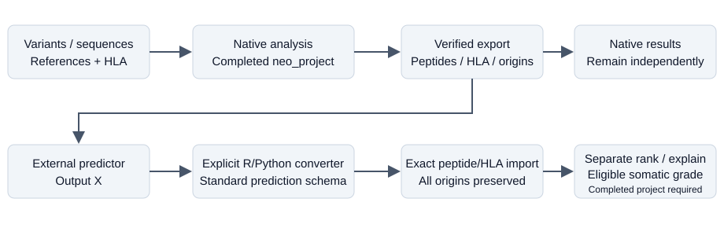

# Neoantimon2

**An integrated neoantigen analysis platform that connects native analysis and
externally developed prediction methods through standardized peptide export,
prediction import, and downstream analysis.**

Neoantimon2 is an R package that links genomic events, reconstructed peptide
origins, peptide–HLA candidates, prediction evidence, and explanations. It retains
all origins, even when several origins produce the same peptide, and keeps
missing evidence distinct from negative evidence.

## Capabilities

- Reconstruct candidate peptides from supported variant and sequence inputs.
- Run configured native predictors and inspect candidates, grades, and provenance.
- Export verified peptide/HLA queries and complete origin annotations.
- Import standardized predictions, or explicitly run local R/Python converters
  and checksum-pinned Community Registry converters.
- Produce separate external ranking, explanations, and eligible somatic grading.
- Support configured longitudinal summaries, vaccine-set selection, and a
  separate literature-derived indirect-HLA workflow.



External analysis attaches to a **completed local `neo_project`**. Exported
bundles can be used for prediction elsewhere; they do not run downstream analysis
independently. Native results remain available independently of external imports.

## Installation

R **4.1.0 or later** is required. This source is the **0.2.0 release candidate**;
public cutover and the `v0.2.0` tag are pending. The tagged installation below is
for use after publication and has not yet been verified against a public release.

The tested local installation is:

```sh
R CMD build .
mkdir -p /your/test/library
R CMD INSTALL --install-tests --library=/your/test/library Neoantimon2_0.2.0.tar.gz
```

After the approved public release:

```r
install.packages("remotes")
remotes::install_github("hase62/Neoantimon2@v0.2.0", upgrade = "never")
```

Runtime dependencies are `jsonlite`, `digest`, `stringi`, `yaml`, `xml2`, and R's
`tools`. Suggested packages are for tests/development. Native dependency builds
may require compilers/system libraries. Licensed predictors and reference data
are acquired separately; neither is needed for the offline example. See
[installation and configuration](docs/user/getting-started.md).

## Native quickstart

Run in an installed package:

```r
library(Neoantimon2)
stopifnot(as.character(packageVersion("Neoantimon2")) == "0.2.0")
source(system.file("examples", "quickstart.R", package = "Neoantimon2"), local = TRUE)
neo_events(p)
neo_origins(p)
neo_results(p, prediction_status = "NOT_RUN")
neo_explain(p, candidate_id = results$candidate_id[[1L]], format = "text")
```

The synthetic example creates **1 event, 7 origins, and 4 candidates**, with
prediction `NOT_RUN` and identical results after reopening. It needs no network,
source checkout, or licensed software. Its tiny references and 3-aa/5-aa windows
are for testing, not clinical analysis. Inputs and runs are written to temporary
storage; `p` is the completed project used below.

For real inputs, use `neo_config()` → `neo_project()` → `neo_run()` and retain
original inputs separately from generated runs. Follow the
[native configuration recipe](docs/user/getting-started.md#configure-your-own-project)
and [workflow guide](docs/user/workflows.md).

## External prediction quickstart

Continue with `p` from the native example. This runnable demonstration simulates
an external model's output X and explicitly selects the installed R converter:

```r
bundle <- neo_export_bundle(p)
queries <- read.delim(file.path(bundle$path, "pmhc_queries.tsv"),
                     colClasses = "character")
x <- data.frame(peptide = queries$peptide_sequence, hla = queries$mhc_key,
                value = seq_len(nrow(queries)))
x_path <- file.path(p$path, "synthetic-X.tsv")
write.table(x, x_path, sep = "\t", quote = TRUE, row.names = FALSE)
policy <- list(mode = "external_rank", provider = "synthetic-model",
  run_id = "demo-run-1", task = "external:synthetic_score", metric = "score",
  score_direction = "higher_is_better")
a <- neo_analyze_external(p, x_path, policy,
  converter = system.file("extdata", "external-example-converter.R",
                          package = "Neoantimon2"))
external <- neo_external_results(a)
neo_external_explain(a, candidate_id = external$candidate_id[[1L]])
```

The converter emits the standard prediction schema. Exact peptide/HLA matching
preserves origin associations. These arbitrary synthetic scores produce a
separate user-selected rank, **not scientific grades or percentiles**. Already
standardized output can be imported directly, without executing any converter.
The [external prediction guide](docs/user/external-predictions.md) covers schema
fields, Python scripts, direct import, eligible grading, and Registry lookup.

The optional [Community Converter Registry](https://www.hase62.jp/Neoantimon2-Converters/)
is maintained separately. Its canonical HTTPS index is
`https://www.hase62.jp/Neoantimon2-Converters/index.json`. Version-specific IDs,
SHA256 verification, explicit first-use execution consent, and approved local
cache reuse are supported. Downloaded scripts run with your privileges; checksums
and community votes do not make them safe. Community OK/NG feedback and manual
snapshots are **not official scientific validation**. The ordinary native
workflow and direct standard import do not need the Registry.

## Documentation

Start with the [documentation index](docs/README.md).

| Topic | Guide |
| --- | --- |
| Installation and native quickstart | [Getting started](docs/user/getting-started.md) |
| Input formats, HLA, and references | [Inputs](docs/user/inputs.md) · [Resources/tools](docs/user/resources-and-tools.md) |
| Native workflows | [Workflows](docs/user/workflows.md) |
| External predictors | [External interoperability](docs/user/external-predictions.md) |
| All twelve public APIs | [API reference](docs/user/api-reference.md) |
| Interpretation and scientific scope | [Results](docs/user/results-and-explain.md) · [Methods/limitations](docs/user/methods-and-limitations.md) |
| Regeneration and source structure | [Reproducibility](docs/user/reproducibility.md) |
| Errors and recovery | [Troubleshooting](docs/user/troubleshooting.md) |
| Contributions and bug reports | [Contributing](CONTRIBUTING.md) |

Installed help is available through `help(package = "Neoantimon2")`,
`?neo_export_bundle`, and `?neo_analyze_external`.

## Supported scope and limitations

Missing is not zero or a biological negative. `NOT_GRADED` is not grade E.
Neoantimon2 does not supply a universal immunogenicity or clinical-risk score;
research grades and selection outputs are not treatment recommendations.

External imports require a completed project and do not automatically integrate
with every vaccine, longitudinal, receptor, presentation, or allo module. Some
providers are imports rather than automatic execution adapters. Acquire licensed
predictors/models from their providers under their terms. Real licensed
predictors, clinical outcomes, and other platforms remain unverified here.
The indirect-HLA profile is literature-derived, not an official PIRCHE
implementation. See [methods and limitations](docs/user/methods-and-limitations.md).

## License

[PolyForm Noncommercial 1.0.0](LICENSE) governs this package; retain the required
[NOTICE](NOTICE). Commercial use requires separate permission or licensing from
Takanori Hasegawa: <hasegawa.t.d968@m.isct.ac.jp>. An inquiry does not grant permission.
Third-party tools, resources, and converters retain their own license boundaries.
This GitHub release candidate is not a CRAN submission.

## Citation

Use [CITATION.cff](CITATION.cff) for the software citation and record the exact
version/commit, input/reference versions, and external providers. A dedicated
Neoantimon2 paper is planned; the software citation is not a peer-reviewed
validation publication. The predecessor Neoantimon paper does not validate this
package.
