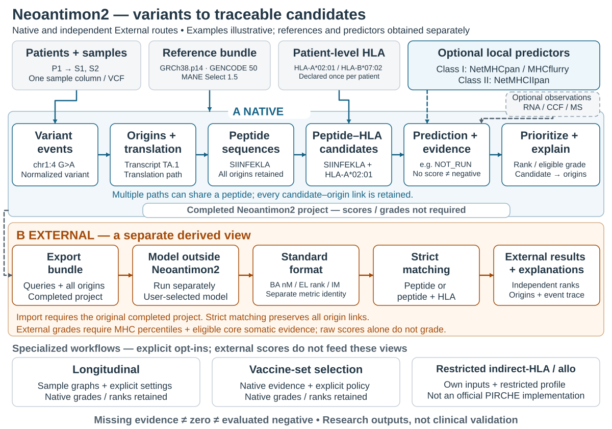

# Neoantimon2

An R package for somatic-variant-derived **neoantigen reconstruction, traceable
predictor integration and assumption-aware experimental planning**. Optional
PIRCHE-inspired workflows also analyze indirect HLA class II presentation.
Candidates and model scores are research outputs, not clinical predictions or
experimental proof of immunogenicity.

## Choose a version

| Version | Public APIs | Choose it for |
| --- | ---: | --- |
| [v0.3.0 — published release](https://github.com/hase62/Neoantimon2/releases/tag/v0.3.0) | 16 | The immutable released baseline; excludes later priority, Yield, reporting and indirect-autorun APIs |
| [Reproducibility Snapshot — reproducibility-v1](https://github.com/hase62/Neoantimon2/releases/tag/reproducibility-v1) | 20 | Fixed research code and the **eight-table saved-result reproduction ZIP**; a GitHub pre-release, separate from the released baseline |
| [main — latest development](https://github.com/hase62/Neoantimon2/tree/main) | 22 | Version **0.3.0.9000**, including the integrated indirect-HLA extensions |

Counts are the `export()` entries in each version's NAMESPACE, excluding S3
methods/imports. Main and the fixed snapshot share a development version number;
record the **commit as well as the package version**. Main is a moving branch.

## Start here

| Your goal | Entry point |
| --- | --- |
| Try the package in five minutes after installation | [Quick Start: small offline synthetic example](#quick-start) |
| Analyze somatic variants | [Inputs and reconstruction](#inputs-and-reconstruction) → [First Real-Data Workflow](docs/user/first-real-data-workflow.md) |
| Import external BA / EL / IM predictions | [External predictor workflow](#external-predictor-workflow) |
| Plan experiments or export complete results | [Experimental Yield](#experimental-yield-estimation) · [Reporting](#complete-result-reporting) |
| Analyze indirect HLA / PIRCHE-inspired presentation | [Scope and one-command workflow](#indirect-hla--pirche-inspired-analysis) |
| Reproduce the Reproducibility Snapshot saved tables | [Package and exact reproduction commands](#reproducibility-snapshot) |

[Installation](#installation) · [Documentation](docs/README.md) ·
[Citation](#citation) · [License](#license)

## Key capabilities

| Capability | Implemented scope |
| --- | --- |
| Reconstruction | Somatic SNVs/indels; supported normalized compound/phased contexts, transcript-aware CDS/protein reconstruction and explicit unsupported states |
| Peptides and HLA | Configurable Class I lengths, including 8–12mers; supported Class II workflows with explicit alpha~beta presenters; every eligible window under the documented reconstruction policy |
| Provenance | Event → Origin → peptide–HLA links; sequence/query deduplication preserves all biological Origins |
| Native assessment | Existing A–E Grade and ranking policies; optional configured native predictors |
| Biological evidence | VCF-first DNA VAF, optional DNA/RNA BAM allele evidence, externally quantified expression, generic CN/purity and supported native ASCAT imports |
| External evidence | Separately identified BA/EL/IM observations, exact peptide/HLA matching and model/run/metric provenance |
| Numerical priorities | `neo_priorities()` keeps prediction-only, exploratory adjusted ordering and original-paper PI/PR methods separate |
| Experiment planning | Optional evidence A–D/B1/B2, independent score-bin rates, yield curves and target candidate counts |
| Reporting | Complete Event, unique-peptide, pMHC and Origin views, independent channel representatives and explicit linkage tables |
| Indirect HLA | One-command local 4.3k BA; DRB1/3/4/5, separately scoped exploratory DQ/DP and 13 configurable precursor loci |

Specialized structural/source, long-read, longitudinal and indirect-HLA workflows
have explicit prerequisites and limited contracts. This is not arbitrary SV,
splice-event or complex-mutation support. See [advanced workflows](docs/user/workflows.md)
and [scientific limitations](docs/user/methods-and-limitations.md).



## Installation

Use R ≥ 4.1.0. Install the current default-branch development package:

```r
install.packages("remotes")
remotes::install_github("hase62/Neoantimon2", ref = "main", upgrade = "never")
```

For the immutable published release instead:

```r
remotes::install_github("hase62/Neoantimon2", ref = "v0.3.0", upgrade = "never")
```

For the fixed reproducibility source, use `ref = "reproducibility-v1"` instead. To
reaggregate its saved tables, download the [reproduction asset](#reproducibility-snapshot);
installing the R package alone does not provide those eight tables.

Restart R before replacing a loaded package. The commands use normal R package
installation; local source build, isolated installation and examples are checked
in the [integration validation recipe](docs/user/reproducibility.md). Network and
system-library/compiler requirements depend on your platform. For exact
reproduction, pin the audited commit rather than a moving branch.

Human references, predictor engines and model weights are not bundled or installed
automatically. Native predictors and BAM readers have optional dependencies;
see [setup](docs/user/setup.md) and [resource/tool contracts](docs/user/resources-and-tools.md).
Acquire licensed tools separately under their terms.

<a id="try-it-in-five-minutes"></a>
## Quick start

This is an executable **synthetic, offline** example. It downloads no references
and invokes no predictor:

```r
library(Neoantimon2)
source(system.file("examples", "quickstart.R", package = "Neoantimon2"), local = TRUE)
results[, c("sample_id", "ligand_sequence", "mhc_key", "prediction_status", "grading_status")]
neo_explain(p, candidate_id = results$candidate_id[[1L]], format = "text")
reopened <- neo_project(path = p$path)
stopifnot(identical(neo_results(reopened), results))
```

The hand-authored example produces **1 Event, 7 Origins and 4 candidates** using
tiny 3-/5-aa test windows. Prediction is `NOT_RUN`, Grade is `NOT_GRADED`; these
are not negative predictions or grade E. These windows are not human-analysis
settings. The script leaves `p`, `events`, `origins` and `results` in R.

<a id="analyze-your-own-data"></a>
## Inputs and reconstruction

Declare sample/patient identity, single-sample tumor VCFs, patient HLA and verified
assembly-compatible reference resources with `neo_config()` and `neo_project()`;
`p <- neo_run(p)` returns a saved project. `neo_results(p)` reads its results.
One sample column per VCF is supported; do not silently rewrite names or invent GT.
Multiple samples use separate declarations, including samples of the same patient.

For a real analysis, explicitly configure desired lengths, for example:

```r
cfg <- neo_config(peptides = list(class_i_lengths = 8:12,
                                  class_ii_lengths = 15L))
```

These are explicit example lengths, not defaults. The historical defaults remain
Class I **8:11** and Class II **13:25**. This only declares configuration; supply
actual references/inputs before executing an analysis. Reference bundles are
normally several GB; retain their full required scope and integrity. Class II candidate generation requires supported complete
presenters, not an invented alpha partner.

Supported tumor VCF FORMAT evidence can supply DNA VAF without BAM or a manual
Event-ID table. DNA BAM is optional fallback/verification; RNA BAM can supply
variant-specific allele support. Expression is imported from external estimates;
Neoantimon2 does not quantify expression from BAM. ASCAT is executed externally;
supported outputs are imported with explicit identity/build/coordinate checks.
Missing observations remain unavailable, and reported fractions do not become
invented read counts. See the [continuous user guide](docs/user/getting-started.md)
and [source evidence and numerical priorities](docs/user/source-evidence-and-priorities.md).

### Before the first real-data run

Follow the [First Real-Data Workflow](docs/user/first-real-data-workflow.md) for
one continuous preparation → diagnosis → execution → interpretation → reopening
recipe, plus an authored synthetic standard-length example. Before `neo_run()`:

```r
source(system.file("examples", "first-real-run.R", package="Neoantimon2"), local=TRUE)
# Use your reviewed cfg/samples/hla/inputs; this creates no project or output:
check <- first_real_run_check(cfg, samples, hla, inputs, output_dir=cfg$paths$run_root)
check$software
check$effective
check$checks
stopifnot(check$ok)
```

The helper is a sourceable example, not a new exported API. It reuses resource,
length and HLA validators, checks VCF header bindings and output permissions,
and keeps paths/identifiers out of default output. No predictor process or
download starts. Configured tools are reported **not probed**; an explicit
`neo_check_predictors(..., smoke_test=FALSE)` can still execute help/version
commands. The guide explains that separate opt-in and how to read `NOT_RUN`,
Origin links and the existing `neo_report_bundle()` tables.

<a id="add-external-predictions-if-needed"></a>
## External predictor workflow

1. Read a completed project and export queries with `neo_export_bundle(p)`.
2. Execute a legitimately obtained predictor separately on supported queries.
3. Convert its unmodified output using a reviewed [Converter Registry adapter](https://github.com/hase62/Neoantimon2-Converters).
4. Import with `neo_analyze_external()` and an explicit policy; inspect
   `neo_external_results()` and `neo_external_explain()`.

| Channel | Modeled quantity | Interpretation |
| --- | --- | --- |
| BA | Peptide–MHC binding | Affinity or provider-defined rank; retain original unit/direction |
| EL | Eluted ligand/presentation | Provider-specific presentation score or rank |
| IM | Immunogenicity | Model-specific output, not experimental demonstration of a T-cell response |

Provider, predictor/model versions, run identity, task, metric, unit, direction,
status and all matched Origins are retained. External evidence does not overwrite
Native results. Raw BigMHC-IM scores are not calibrated experimental positive
probabilities. BA, EL and IM scales are not interchangeable and are not combined
into a universal score. The Registry supplies converters, not predictor engines.
See the [external contract and offline example](docs/user/external-predictions.md).

## Experimental Yield Estimation

`neo_yield_evidence()` describes experimental-reference evidence for each exact
peptide–HLA pair, separately from Native A–E Grades:

- **A:** exact peptide and exact HLA tested; retain positive/negative/conflicting records.
- **B1:** exact peptide, different HLA. **B2:** exact HLA, equal-length peptide
  differing at one residue. Both subtypes may apply; neither proves equivalent TCR recognition.
- **C:** sufficient exact-HLA reference records under configurable provisional thresholds.
- **D:** limited reference evidence, not low immunogenicity. An unavailable database
  gives an explicit unavailable status rather than an invented category.

`neo_experimental_yield()` independently assigns four score bins and profile
rates. Evidence A–D/B1/B2 **never modifies the probabilities**. Frozen,
predictor/endpoint-specific empirical profiles and explicitly assumed exploratory
scenarios are distinct modes. The bundled IMPROVE-derived scenario is **not** a
validated BigMHC-IM/BA/EL calibration or patient-specific probability.

Default planning counts each unique peptide sequence once per sample. Its
best-scoring HLA is a labeled primary proxy; all alternative HLA/candidate/Origin
associations remain available. Expected positive count `sum(p_i)` differs from
probability of at least one positive `1 - prod(1 - p_i)`, which assumes independent
outcomes. Targets 50/80/90/95% return unavailable plus a reason when unreachable;
no artificial candidates are added.

Run the explicitly synthetic numerical illustration:

```r
source(system.file("examples", "experimental-yield.R", package = "Neoantimon2"), local = TRUE)
plan <- experimental_yield_example()
plan$summary
plan$targets
plot(plan)
```

This standalone numerical example is not evidence for the genomic demo above.
For saved Native or imported External results, use the
[Experimental Yield guide](docs/user/experimental-yield.md) and an explicit reference/profile.

<a id="understand-your-results"></a>
## Complete result reporting

`neo_report_bundle()` is a read-only export, separate from the existing
`neo_export_bundle()` interoperability/hash contract. For the completed Quick Start:

```r
report <- neo_report_bundle(p, dir = tempfile("neo-report-"))
report$tables$event_summary
report$tables$event_best_by_channel
report$tables$pmhc_candidates
```

Its Event representatives are unavailable in this unpredicted demo, truthfully.
For a completed research project, optionally supply explicit existing external
analyses and a yield plan **derived from that same project's candidates**:

```r
# These variables refer to your existing completed project/analysis/plan:
research_report <- neo_report_bundle(p_saved, dir = "new-research-report",
  analyses = list(existing_external_analysis_id), yield_plan = plan_for_this_project)
```

| View | Meaning |
| --- | --- |
| Event | Original mutation, associations and separately selected Native/exact external channel representatives |
| Peptide | Unique sequence per sample; optional synthesized-peptide planning and primary-HLA proxy |
| pMHC | Every candidate and every matched selected-analysis prediction, including alternative HLAs |
| Origin | Every molecular path, transcript, gene, source Event and available evidence association |

A best candidate never replaces alternatives. Native selection uses existing
rank semantics; external selection stays within a compatible model/run/task/metric,
unit, sample and MHC class. Complete candidate–Origin, Origin–Event and
candidate–peptide linkage tables retain joint multi-Event source sets and separate
germline context; compound peptides are not claimed to arise independently from
each member Event. List fields use JSON rather than being discarded from TSV.

```text
new-research-report/
  manifest.json
  events.tsv, event_summary.tsv, event_best_by_channel.tsv
  peptide_summary.tsv, pmhc_candidates.tsv, pmhc_predictions.tsv
  origins.tsv, candidate_origin_links.tsv, origin_event_links.tsv
  candidate_peptide_links.tsv, molecular_event_evidence.tsv, ...
  experimental_yield_*.tsv    # only when a plan is supplied
```

See [complete reporting](docs/user/result-reporting.md) for selection policies,
full table schemas, precision boundaries, bounded output and current limitations.
Longitudinal aggregate handles require reporting individual underlying projects.

## Indirect HLA / PIRCHE-inspired analysis

Available in **main**, `neo_indirect_class2()` automates a research workflow:
explicit donor/recipient typing → pinned official IPD reference → full-precursor
15mers → local NetMHCIIpan 4.3k BA → oriented 9mer self comparison → linked results.
No manual predictor TSV conversion is required. Genuine **NetMHCIIpan 4.3k
Darwin_arm64 technical E2E** has been verified for selected exact DRB1/3/4/5,
DQ and DP presenters, using official IPD proteins and fictional typing. This is
not patient-expression or clinical validation; see [scoped evidence](docs/development/indirect-class2-validation.md).

```r
run <- neo_indirect_class2(donor=donor_typing, recipient=recipient_typing,
  profile="dr-expanded-v1",
  installation=list(path=netmhciipan_root,
    authorization=list(status="authorized_local_installation",
                       terms=accepted_local_license_description)),
  reference=list(release="3.66.0",cache="ipd-cache"),
  output_dir="indirect-expanded-run")
run$result$group_summary
```

[Typing examples, setup, results and complete instructions](docs/user/indirect-class2.md)
define these setup values. Sources are configurable A/B/C, DRB1/3/4/5,
DQA1/DQB1, DPA1/DPB1 and MICA/MICB. Missing, absent and partial loci remain distinct;
DRB1 never implies an additional DR gene or its copy count. DRA–DRB1/3/4/5 is
separate from the exploratory `dqdp-exploratory-v1` profile, which requires
explicit typed DQA1–DQB1 / DPA1–DPB1 pairs with user-declared expression.
No Cartesian pairing or fuzzy allele substitution is performed.
Automatic DR pairing assumes expression from explicitly typed chains; it does
not establish experimental expression. Presenter metadata distinguishes
`expression_basis="typing_based_assumption"` from `"user_declaration"` and records
`experimental_expression_status="not_verified_by_workflow"` in both cases.
The retained `expression_confirmed` flag is an analysis-admission declaration,
not proof of measured expression; eligibility and counting are unchanged.

The reference is retrieved or hash-verified from a versioned cache; processed
IPD data remain local under [upstream terms](https://github.com/ANHIG/IMGTHLA/blob/3660/LICENCE.md).
Install the [licensed predictor](https://services.healthtech.dtu.dk/services/NetMHCIIpan-4.3/)
separately; code/weights are never downloaded or redistributed by Neoantimon2.
BA is explicitly requested and EL remains separate. The isotype-specific
1000 nM cutoffs are declared assumptions, not calibrated clinical probabilities.
Counts retain exact core/orientation/presenter and every source Origin/link.
Incomplete results expose NULL counts and reasons; DQ/DP are never a pooled risk.

This is not official PIRCHE v4/Frost, PIRCHE-I or B-cell matching, and no clinical
or official numerical equivalence is established. The [legacy DRB1 autorun](docs/user/indirect-autorun.md)
remains unchanged, including explicit NetMHCIIpan 3.2 support. These optional
features are not part of immutable v0.3.0 or frozen reproducibility-v1. The installed
`examples/indirect-class2.R` provides a clearly labeled synthetic mock workflow.

## Reproducibility Snapshot

A versioned research reproducibility snapshot with supporting data and verification scripts.

Use the [reproducibility-v1 GitHub pre-release](https://github.com/hase62/Neoantimon2/releases/tag/reproducibility-v1)
and its **Neoantimon2_Reproducibility_v1.zip** asset, rather than the
automatically generated source-code ZIP. It contains eight preserved HCC1395
tables, pinned source archives, checksums and read-only standard-Python scripts.
They reaggregate **15 peptides, 75 pMHCs, 36 Origins, 180 links and 300 external
measurements**. No R, genome reference or model weights are needed for that replay.
See [download, SHA-256 and exact commands](docs/user/reproducibility.md#snapshot-saved-result-reproduction).

This is saved-result reaggregation, separate from molecular reconstruction,
new predictor inference or a complete VCF-to-results rerun. The fixed snapshot
has 20 APIs and does not include main's later indirect-HLA autorun extensions.

<a id="scientific-limitations"></a>
## Validation and scientific boundaries

[Versioned validation evidence](docs/development/validation-evidence.md) distinguishes
historical evidence from version-specific integration checks. GitHub Actions CI
is not configured; no CI badge or automated CI success is claimed:

- Independent synthetic molecular oracles cover supported sequence reconstruction;
  qualified/unsupported cases remain qualified, not rewritten as unconditional PASS.
- HCC1395 cell-line saved outputs account for 41,072 source variants, 244,191
  Origins, 110,030 pMHC candidates and 949,015 links. The original driver was
  SIGTERM-terminated (controller 143); later saved-result verification is separate.
- Genuine MHCflurry BA and BigMHC EL/IM pilot executions and Converter imports
  were verified, including exact matching of five HCC1395 Class I alleles.
- A genuine bounded pVACseq comparison audited matched contexts and explained
  eligibility/window/WT differences; it does not establish either tool's clinical superiority.
- Yield/reporting tests verify unchanged mathematics, complete alternatives,
  representative/link integrity and read-only reopening. The preserved reporting
  pilot has 15 peptides, 75 pMHCs, 180 links and 300 separate prediction records.

Software correctness, genuine model execution and interoperability are different
from **experimental immunogenicity validation**. None establishes clinical utility.
Modern adjusted BA/EL/IM priorities remain exploratory and candidate-set-dependent.
Published PI/PR mathematical reproduction has its documented missing-input and CCF
limitations. Human reference, annotation, HLA and predictor support must match the
actual analysis. Preserve inputs, versions, hashes and all completed outputs.

<a id="major-capabilities"></a>
## Documentation and references

- [Documentation index](docs/README.md), [practical guide](docs/user/getting-started.md),
  [Public API reference](docs/user/api-reference.md).
- [Inputs](docs/user/inputs.md), [VCF limits](docs/user/vcf-compatibility.md),
  [setup](docs/user/setup.md), [cohort examples](docs/user/multi-sample-examples.md).
- [Grades/explanations](docs/user/results-and-explain.md),
  [source evidence/priorities](docs/user/source-evidence-and-priorities.md),
  [external import](docs/user/external-predictions.md), [advanced workflows](docs/user/workflows.md).
- [Experimental Yield](docs/user/experimental-yield.md), [result reporting](docs/user/result-reporting.md),
  [reproducibility/source layout](docs/user/reproducibility.md), [scope limitations](docs/user/methods-and-limitations.md).
- [AI-assisted analysis playbook](docs/ai/ANALYSIS_PLAYBOOK.md),
  [original Neoantimon paper](https://doi.org/10.1093/bioinformatics/btaa616),
  [software citation](CITATION.cff), [Converter Registry](https://github.com/hase62/Neoantimon2-Converters).

## Citation

Use [CITATION.cff](CITATION.cff) and record the exact tag/commit used. The current
main is unreleased development software; the Neoantimon2 manuscript is not a
published validation paper and no manuscript DOI is assigned here.

Neoantimon2 succeeds the original [Neoantimon](https://github.com/hase62/Neoantimon),
described by Hasegawa et al., *Bioinformatics* (2020),
[doi:10.1093/bioinformatics/btaa616](https://doi.org/10.1093/bioinformatics/btaa616).
That publication describes the predecessor, not every Neoantimon2 extension.

## License

[PolyForm Noncommercial 1.0.0](LICENSE); retain [NOTICE](NOTICE). Commercial use
requires separate permission/licensing from Takanori Hasegawa
(<hasegawa.t.d968@m.isct.ac.jp>); an inquiry does not grant permission.
Third-party tools, resources and converters retain their own terms.
