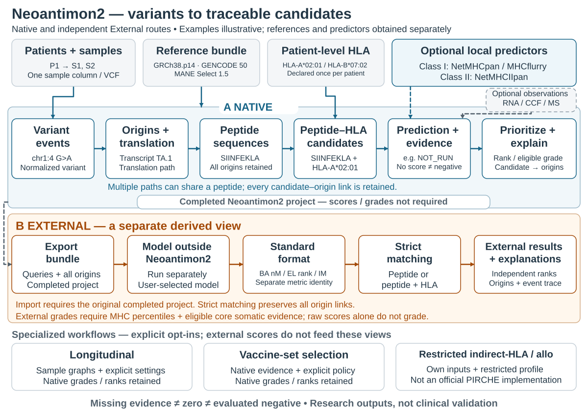

# Neoantimon2

Turn supported genomic variants into **traceable neoantigen candidates**. Neoantimon2
reconstructs altered peptide sequences, pairs them with the HLA molecules you declare,
and helps you inspect predictions and supporting evidence in R. You can trace each
candidate back to the sequence paths and variants that produced it.

This is a **research tool**: a candidate or prediction does not establish clinical
immunogenicity or treatment efficacy.



[Try the example](#try-it-in-five-minutes) · [Your data](#analyze-your-own-data) ·
[Read results](#understand-your-results) · [External predictions](#add-external-predictions-if-needed)

## What goes in, and what comes out?

| You provide | Concrete example | Important constraint |
| --- | --- | --- |
| Samples and patients | S1 and S2 belong to P1; S3 belongs to P2 | Declare the mapping explicitly |
| Variant files | `S1.vcf`, `S2.vcf`, `S3.vcf` | One sample column per VCF; its name must match `sample_id` |
| Patient HLA | P1: `HLA-A*02:01`, `HLA-B*07:02` | Supplied by you; no automatic HLA typing |
| Compatible references | GRCh38.p14; GENCODE 50; MANE Select 1.5 | Genome + FAI, annotation + sequence catalogs/Sec metadata, MANE summary + GTF |

RNA, read counts, clonality and MS observations are **optional**, supplied through
their supported evidence formats. Absent evidence remains unknown.

You get a saved run at `p$path`: **events** (variants), **origins**
(sequence/translation paths) and **candidates** (peptide + HLA within a sample).
Read them in R and trace their relationships with `neo_explain()`. Query and
annotation files are saved in `results/export_bundle/`; native assessments are
read through `neo_results()`.

## Try it in five minutes

### Installation

Use R ≥ 4.1.0 and install the immutable public v0.3.0 release:

```r
install.packages("remotes")
remotes::install_github("hase62/Neoantimon2", ref = "v0.3.0", upgrade = "never")
```

The example needs only the installed package and its R dependencies. It downloads
no references and runs no predictor. Real human references, predictor programs
and model weights are **not bundled**. Installation time depends on your network
and dependencies; source builds can require compilers/system libraries.

### Quick Start

```r
library(Neoantimon2)
source(system.file("examples", "quickstart.R", package = "Neoantimon2"), local = TRUE)
results[, c("sample_id", "ligand_sequence", "mhc_key",
  "prediction_status", "grading_status")]
neo_explain(p, candidate_id = results$candidate_id[[1L]], format = "text")
```

Expect **1 event → 7 origins → 4 candidates**. The candidate peptides are `KPK`,
`MNK`, `NKP` and `MKP`, all paired with `HLA-A*02:01`. These tiny test windows and
hand-authored references demonstrate the software; they are not human analysis
settings or validated neoantigens.

Prediction is **`NOT_RUN`** because no predictor was requested. Grading is
**`NOT_GRADED`** because the required evidence was not supplied. The script prints
the temporary location of its files and verifies identical results after
reopening. It leaves `p`, `events`, `origins` and `results` ready to inspect.

## Analyze your own data

First obtain a complete reference bundle in a durable data directory. From R,
`neo_download_resources(profile = "minimum", dest = data_dir)` obtains the supported
genome/GENCODE/MANE profile and reuses verified cached files. This is a **several-GB
operation**, separate from the demo; creating a missing genome FAI requires
`samtools`. Do it deliberately, with sufficient disk space. Other compatible
reference configurations can be supplied explicitly.

The following recipe assumes that profile is already available. **Replace the
three paths, the sample/patient IDs and the HLA values with your own declarations.**
The VCF header must name S1 in this example; do not relabel a patient's file to
make it match. Keep inputs/references outside the run directory.

```r
data_dir <- path.expand("~/neo-data")
run_dir <- path.expand("~/neo-runs")
vcf_path <- path.expand("~/samples/S1.vcf")

refs <- neo_check_resources(profile = "minimum", dest = data_dir)
stopifnot(refs$ok)
cfg_user <- neo_config(env = character(),
  paths = list(data_root = data_dir, run_root = run_dir),
  scientific = refs$scientific, resources = refs$resources)
p_user <- neo_project(
  samples = data.frame(sample_id = "S1", patient_id = "P1"),
  hla = list(P1 = c("HLA-A*02:01", "HLA-B*07:02")),
  config = cfg_user,
  inputs = list(list(input_id = "S1-somatic", input_role = "somatic_vcf",
    sample_id = "S1", path = vcf_path)))
p_user <- neo_run(p_user)
r_user <- neo_results(p_user, sample_id = "S1")
```

`neo_project()` declares the project; `neo_run()` executes it. This recipe requests
no predictor. To use native NetMHCpan, NetMHCIIpan or MHCflurry, configure a
legitimately obtained installation first; `neo_check_predictors()` reports what
is available. Missing predictions are not negative predictions.

For more samples, add rows to `samples` and separate records to `inputs`. HLA
stays keyed by **patient**, so S1 and S2 can share `hla$P1`. Class II requires an
explicit alpha~beta pair, e.g. `HLA-DRA*01:01~HLA-DRB1*15:01`.
A single VCF with multiple sample columns is unsupported.

The [practical user guide](docs/user/getting-started.md) continues this exact
recipe through reference checking, multiple samples, results and external import.

## Understand your results

```r
neo_events(p)                         # normalized variant observations
neo_origins(p)                        # peptide-producing paths
neo_results(p, sample_id = "sample-1") # peptide–HLA candidates in the demo
reopened <- neo_project(path = p$path)
stopifnot(identical(neo_results(reopened), neo_results(p)))
```

One event can contribute to several origins. Different origins can yield the
same peptide; candidate deduplication retains **all** those links. A candidate
is a possibility to investigate, not a measured immune response.

`prediction_status` says whether prediction evidence is available; inspect its
reasons with `neo_explain()`. `NOT_RUN` can also reflect unavailable, unsupported
or failed primary evidence. `NOT_GRADED` is not grade E. Numerical zero, missing
values and explicitly evaluated negative evidence are different states.

The saved Export Bundle includes `events.tsv`, `origins.tsv`, `candidates.tsv`,
unique `peptides.tsv` / `pmhc_queries.tsv` and `candidate_origin_links.tsv`.
These are queries and annotations, not a substitute for native assessment.

Ranks and somatic A–E grades depend on evidence, technical eligibility and the
active policy. They are not universal immunogenicity probabilities. Some sources
have no somatic grading policy. Save whole R tables with `saveRDS()` to retain
nested provenance; choose scalar columns explicitly for a flat CSV.

## Add external predictions if needed

Use this route when you want a method outside the configured native predictors:

1. Export the completed project: `bundle <- neo_export_bundle(p)`.
2. Run your chosen prediction engine **separately**, using its supported queries.
3. Run a reviewed **Converter** if its output needs adaptation to the standard TSV.
4. Import into the original project with `neo_analyze_external()`; inspect with
   `neo_external_results()` and `neo_external_explain()`.

| Target | What it models | Example measurement |
| --- | --- | --- |
| BA | HLA binding affinity | IC50 in nM; lower is better |
| EL | Eluted ligands / antigen presentation | Provider score or percentile, each with its own direction |
| IM | T-cell immunogenicity | Model score or percentile, not an EL percentile |

The independent Converter Registry supplies **format adapters**, not prediction
engines. It currently offers nine BA/EL/IM adapters across eight method families,
plus a synthetic example. Its [conversion walkthrough](https://github.com/hase62/Neoantimon2-Converters#readme)
shows selection, checksums, commands and import in one place.

A completed project can export even without native scores or grades. Keep that
project: the bundle is not a standalone replacement. Import uses strict peptide
or peptide+HLA matching, retains every matched Origin and produces **separate**
external results; native results stay unchanged. Raw scores do not automatically
receive A–E grades. Do not compare BA, EL and IM as one score.

For an entirely offline external example, run:

```r
source(system.file("examples", "external-predictions.R", package = "Neoantimon2"),
  local = TRUE)
```

It uses synthetic model-format values and a local converter, not an upstream
prediction engine. It checks independent results and preservation of origins.

<a id="major-capabilities"></a>

## Advanced capabilities and further reference

These are explicit opt-ins, not automatic consequences of having several samples:
longitudinal comparisons require sample graphs and settings; vaccine-set selection
requires a selection policy; restricted indirect-HLA/allo analysis has separate
inputs and scientific scope and is **not an official PIRCHE implementation**.
They do not rewrite underlying somatic grades/ranks or automatically consume
every external analysis.

### Documentation

Read the **[practical user guide](docs/user/getting-started.md)** for a continuous
own-data workflow. Then use references for a specific question:

- [Input specifications](docs/user/inputs.md), [resource/tool reference](docs/user/resources-and-tools.md),
  [setup options](docs/user/setup.md) and [VCF limits](docs/user/vcf-compatibility.md).
- [Result fields and grade rules](docs/user/results-and-explain.md),
  [external import contract](docs/user/external-predictions.md),
  [advanced workflows](docs/user/workflows.md) and [16 APIs](docs/user/api-reference.md).
- [Executable cohort recipes](docs/user/multi-sample-examples.md),
  [concrete file examples](docs/user/input-output-examples.md) and [troubleshooting](docs/user/troubleshooting.md).

Codex and Claude Code use the shared [analysis playbook](docs/ai/ANALYSIS_PLAYBOOK.md)
through `AGENTS.md` / `CLAUDE.md`. Instructions cannot supply missing data or consent.

<a id="scientific-limitations"></a>

## Scientific limitations and reproducibility

Candidates, grades and model predictions do not establish clinical immunogenicity,
treatment efficacy or risk. Converter tests establish format/import behavior, not
model accuracy. Licensed predictor execution, actual MHCflurry installation and
other platforms were not comprehensively validated; release validation used
macOS arm64 / R 4.5.1. Record exact package, reference and model versions, input
checksums and settings. Keep original inputs and completed runs.
[Scientific scope](docs/user/methods-and-limitations.md) and
[reproducibility details](docs/user/reproducibility.md) remain available.

## Citation

Use [CITATION.cff](CITATION.cff) and record the software version/commit. A dedicated
paper is planned; the software citation and predecessor Neoantimon paper do not
constitute validation of this package.

## License

[PolyForm Noncommercial 1.0.0](LICENSE); retain [NOTICE](NOTICE).
Commercial use requires separate permission/licensing from Takanori Hasegawa
(<hasegawa.t.d968@m.isct.ac.jp>); an inquiry does not grant permission.
Third-party tools/resources/converters retain their own terms. This is not a CRAN submission.
