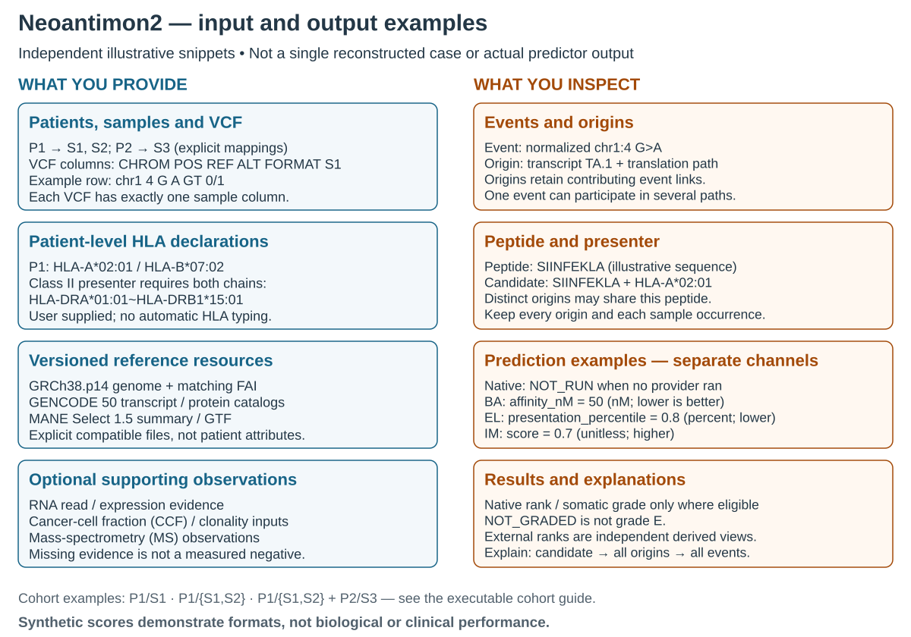

# Recognize input and output files

This is a visual supplement to the [practical user guide](getting-started.md),
not another starting point. The guide contains the executable R declarations.

[SVG](../assets/neoantimon2-input-output-examples.svg) ·
[PNG](../assets/neoantimon2-input-output-examples.png) ·
[Vector PDF](../assets/neoantimon2-input-output-examples.pdf) ·
[Editable source](../assets/source/neoantimon2-input-output-examples.drawio)

The panels are **independent synthetic examples**, not a linked human analysis.
The left declarations show P1/S1/S2 and P2/S3. HLA is declared once per patient;
Class II shows both alpha and beta chains. The VCF has all ten columns, a valid
FORMAT declaration and one sample S1. Display spacing expands real tab separators;
the draw.io metadata and practical guide retain the tab-separated text.

Reference filenames illustrate the required external resources: genome FASTA/FAI,
GENCODE GTF and sequence catalogs/Sec metadata, and MANE summary/GTF. Versions
are selected explicitly; they are not inferred patient properties. Optional
RNA/CCF/MS evidence comes from its own supported tables; no file is not a
measured negative.

The output panel uses values verified from the official hand-authored Quick Start:
chr1:4 G>A, transcript TA, peptide KPK and HLA-A*02:01. Its original sample is
`sample-1`, not the independent P1/S1 input panel. KPK is a **3-aa technical test
window**, not a human predictor query or validated neoantigen. There are seven
origins/four candidates overall; the figure shows record shapes, not all rows or
one universal event→origin cardinality. `NOT_RUN` / `NOT_GRADED` reflect absent
prediction/grading evidence, not zeros or negatives. Explain retains the full
candidate→origins→events trace, not just the abbreviated display.

Regenerate with the [existing renderer](workflow-overview.md#maintain-or-reuse-the-figure),
substituting the `neoantimon2-input-output-examples` basename. Full-size viewing is
recommended for literal file columns; the main README diagram remains the compact
conceptual entrypoint. [Four cohort recipes](multi-sample-examples.md) remain
available for complete one-/two-patient executable setups.
